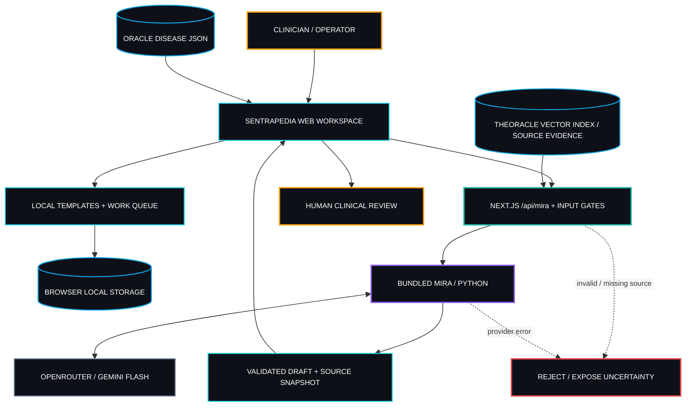
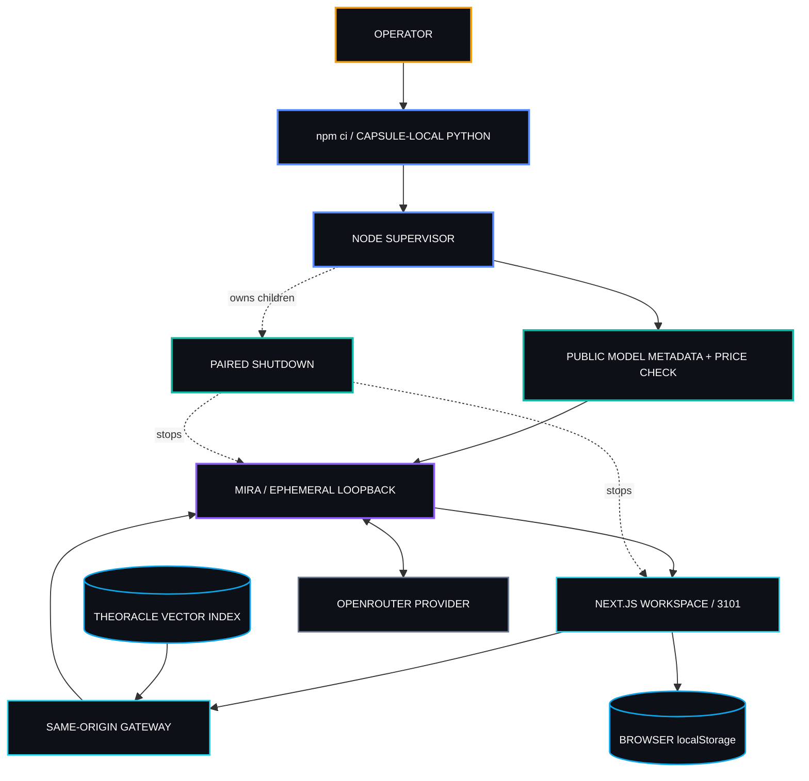
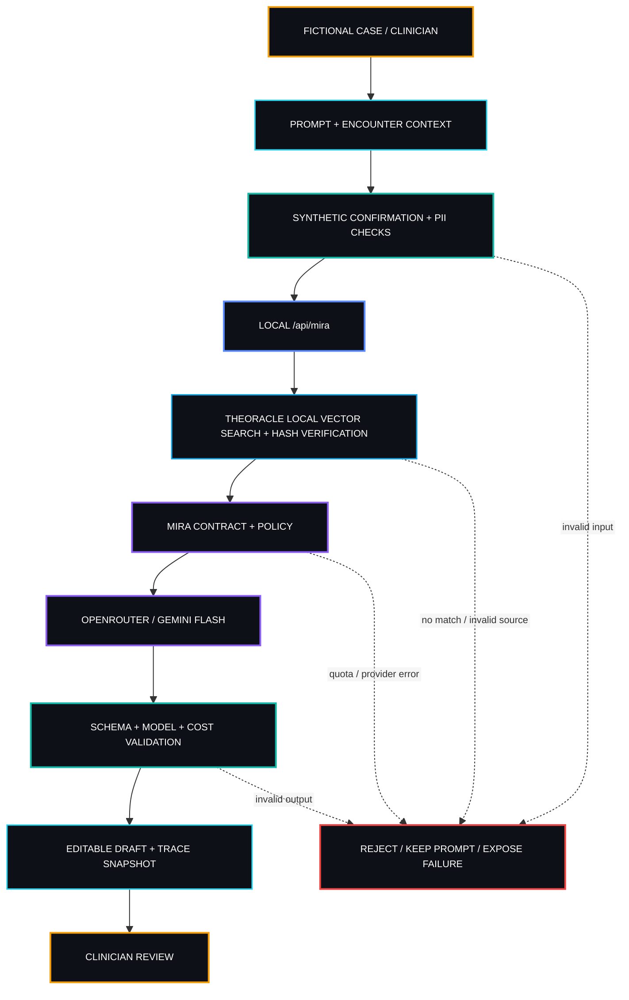
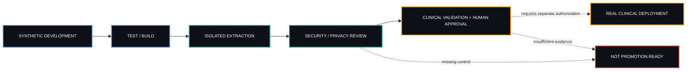

<p align="center">
  
</p>

## 01 / ORIGIN SIGNAL

<sub><code>THE MISSION / CLINICAL INTELLIGENCE WITH HUMAN AUTHORITY</code></sub>

### One question. Traceable evidence. A clinician in control.

**Sentrapedia is an Indonesia-first clinical reasoning and documentation workspace** for exploring fictional encounters. It connects a question or clinical presentation to structured differential considerations, diagnostic workup, inspectable reference evidence and an editable document—without moving the final decision away from the clinician.

The application speaks primarily in **Bahasa Indonesia**, retaining familiar English medical terminology where clinically useful. It brings encounter context, disease references, source-grounded reasoning, document templates and draft revision into a single operator workflow. It is a development-stage clinical intelligence product, **not a general-purpose chatbot, autonomous diagnostic system or deployed EHR**.

**The problem** is not a shortage of generated medical text. It is the difficulty of connecting a clinical question to its original context, the evidence consulted, the reasoning presented, and the person accountable for the decision.

**The purpose** is to make that chain visible—without presenting an experimental model as a clinician, an unreviewed reference as a verified guideline, or a development workspace as a production EHR.

**Designed for:** clinicians and developers exploring synthetic clinical cases and documentation workflows. **Final authority:** the reviewing clinician for clinical interpretation; the authorized owner for high-impact system decisions.

**Current scope:** fictional patients and encounters, drafts and templates, clinical work tasks, optional dictation, local exports, Oracle reference search, TheOracle source grounding, managed MIRA analysis and human review.

**Outside scope:** real patient records, prescribing automation, autonomous medical decisions, production EHR integration, clinical certification and live clinical deployment.

### Repository layout

Sentrapedia is one sovereign product capsule and one future repository. The clinical workspace currently remains at the capsule root. The public marketing website lives in [`apps/site`](apps/site/README.md), with its own static source, assets, site-specific SPDS documentation, and local verification scripts. A future demo belongs under `apps/demo/` as configuration plus synthetic data around shared product code.

---

**01 / WORKSPACE** — Organize fictional cases, notes, templates, tasks, drafts and revisions.

**02 / ORACLE + THEORACLE** — Search the bundled disease catalog and trace supporting source evidence with explicit review limits.

**03 / MIRA** — Produce structured case-analysis drafts through a managed engine; retain validation and clinician review as separate steps.

<sub><code>ONE WORKSPACE · THREE DISTINCT RESPONSIBILITIES · HUMAN-GOVERNED</code></sub>


### The clinical problem we are building around

A clinician's question rarely ends with a single answer. It usually progresses through **case synthesis → differential diagnosis → uncertainty and red flags → diagnostic next steps → evidence inspection → a reviewable note**. When those steps sit in disconnected tools, the operator must repeatedly restate the case, reconstruct why a possibility was considered and manually reconnect a recommendation to its source.

Sentrapedia's product direction is to make that reasoning path a first-class part of the workspace: the **case**, **questions**, **candidate interpretations**, **source provenance** and **editable output** should stay meaningfully connected. The current build implements selected parts of this journey for synthetic data; it does not claim medically validated end-to-end automation.

### What Sentrapedia helps an operator explore

| <small>Clinical task</small> | <small>Operator's question</small> | <small>Available product surface</small> | <small>Human checkpoint</small> |
|---|---|---|---|
| <small>Clinical consultation</small> | <small>What does this fictional presentation raise, and what information is missing?</small> | <small>MIRA clinical Q&amp;A; inspectable context and available source grounding</small> | <small>Check assumptions, source quality and applicability</small> |
| <small>Differential diagnosis</small> | <small>What alternative explanations should be considered?</small> | <small>Structured DDx drafting from synthetic case context</small> | <small>Re-rank or reject candidates; assess safety-critical omissions</small> |
| <small>Diagnostic workup</small> | <small>What questions or investigations might distinguish the candidates?</small> | <small>MIRA workup draft and reference inspection</small> | <small>Judge necessity, feasibility, urgency and local standards</small> |
| <small>Referral assessment</small> | <small>Does the fictional case warrant referral consideration, and what should the handoff contain?</small> | <small>MIRA referral/disposition analysis draft</small> | <small>Verify necessity, disposition and handoff information</small> |
| <small>Classification</small> | <small>Which diagnostic coding candidates could describe the documented condition?</small> | <small>MIRA ICD-10 candidate drafting</small> | <small>Confirm coding rules, specificity and documentation</small> |
| <small>Clinical documentation</small> | <small>How can the fictional encounter become a usable note?</small> | <small>Built-in document modes, local templates, editable drafts and revisions</small> | <small>Approve wording, facts, interpretation and final use</small> |

**These are separate capabilities, not a claim that all modes invoke the same model or that every answer has an authoritative citation.** The repository contains 18 built-in document modes; five explicit modes route through MIRA. Some document operations are local and deterministic.

### A fictional case, end to end

The following is an **illustrative operator journey**, not a recorded clinical validation, benchmark or autonomous care pathway.

1. **Capture context.** Open a fictional encounter and enter a non-identifying chief complaint, chronology, examination findings and relevant simulated history.
2. **Ask a focused clinical question.** Use the clinical Q&A or differential mode to turn that context into a structured inquiry, not a final diagnosis.
3. **Explore the possibilities.** Examine provisional alternatives, missing discriminating information and any warnings or uncertainty presented in the draft.
4. **Inspect the evidence.** Review Oracle disease catalog context and TheOracle provenance-linked passages where valid sources are available; source presence does not establish source correctness.
5. **Draft the next artifact.** Use a workup or referral-assessment inquiry, then shape the results into an appropriate editable documentation format.
6. **Review and revise.** Inspect source snapshots, trace metadata and the clinical content itself. The model's schema checks are not a clinical sign-off.
7. **Keep accountability visible.** The fictional case remains subject to clinician review; nothing in this sequence permits deployment for real patient decisions.

### Indonesia-first is a product direction, not a certification

- **Language and workflow:** the interface is primarily Bahasa Indonesia and is framed around clinician-readable medical documentation rather than generic AI chat responses.
- **Clinical reasoning as the center:** question answering, differential analysis, source inspection and drafting are adjacent activities rather than unrelated text-generation demos.
- **Evidence transparency:** TheOracle retains index, embedding-model and chunk-hash metadata so operators can examine provenance and recognize when retrieval is missing or uncertain.
- **Professional accountability:** the product keeps the reviewing clinician in the decision loop; the agent proposes, the operator evaluates.
- **Important distinction:** Indonesia-first **does not mean** the available corpus has been exhaustively validated against Indonesian national guidelines, that terminology/coding is certified, or that the software integrates with SATUSEHAT, BPJS or a production RME.

<details>
<summary><b><code>PRODUCT HORIZON // VISION VS. CURRENT BUILD</code></b></summary>

**Implemented or configured in this repository:** local synthetic encounter workspace; document templates; Oracle disease catalog; TheOracle read-only local vector retrieval; bundled MIRA case modes; schema/identity gates; edit-and-review workflows; local exports and limited runtime trace information.

**Still requires independent engineering and validation before any real-world clinical application:** secure patient identity and access controls; compliant personal-data processing and retention; formally curated Indonesian clinical evidence; evaluation of medical correctness, bias, red flags and failure modes; oversight and regulatory assessment; robust multiuser infrastructure; institution-approved RME interoperability; real-case pilots and explicit clinician/owner authorization.

**No timeline, certification, institution, clinical outcome or interoperability claim is implied by this direction.**

</details>

## 02 / DOCTRINE

> [!IMPORTANT]
> **The system may draft a clinical interpretation. It cannot authorize a clinical decision.** Sentrapedia is a synthetic-only development workspace, not a clinically validated diagnosis or treatment service.

<table width="100%">
<tr>
<td width="50%" valign="top"><small><b><code>SOURCE BEFORE CERTAINTY</code></b></small><br /><small>Preserve source IDs, page positions, hashes and uncertainty. A text match is not clinical proof.</small></td>
<td width="50%" valign="top"><small><b><code>MANAGED, NOT HIDDEN</code></b></small><br /><small>One supervisor owns MIRA startup, profile/readiness checks, and coordinated shutdown.</small></td>
</tr>
<tr>
<td width="50%" valign="top"><small><b><code>FICTIONAL BY CONTRACT</code></b></small><br /><small>Explicit synthetic confirmation, local-only origin checks, and layered identity-pattern screening.</small></td>
<td width="50%" valign="top"><small><b><code>REVIEW BEFORE ACTION</code></b></small><br /><small>Result metadata and draft revisions remain inspectable. Missing clinical information is not silently invented.</small></td>
</tr>
<tr>
<td width="50%" valign="top"><small><b><code>ONE PROBLEM, THEN DEPTH</code></b></small><br /><small>Prove the synthetic encounter-review workflow before any clinical expansion.</small></td>
<td width="50%" valign="top"><small><b><code>NO MAGIC WITHOUT AUDIT</code></b></small><br /><small>Separate configured controls, executed software tests, source quality and clinical accuracy.</small></td>
</tr>
</table>

## 03 / PRODUCT TOPOLOGY

<p align="center">


</p>

<details open>
<summary><b><code>PRODUCT TOPOLOGY // SOURCE-AWARE CLINICAL WORKSPACE</code></b></summary>



</details>

### Component map

<table width="100%">
<tr>
<td width="50%" valign="top"><small><b><code>01 · WORKSPACE</code></b></small><br /><small>Fictional patients, lists, encounters, tasks, templates, draft review and backups.</small><br /><sub>IMPLEMENTED · src/components · src/lib/workspace.ts</sub></td>
<td width="50%" valign="top"><small><b><code>02 · ORACLE CATALOG</code></b></small><br /><small>144 disease records across 15 categories, searchable by name, code and category.</small><br /><sub>IMPLEMENTED · oracle/sentrapedia.json · src/lib/theoracle.ts</sub></td>
</tr>
<tr>
<td width="50%" valign="top"><small><b><code>03 · THEORACLE</code></b></small><br /><small>Local vector retrieval (EmbeddingGemma-300m on this machine) with index, model and per-passage hashes and bounded passages.</small><br /><sub>IMPLEMENTED · theoracle · src/lib/theoracle-grounding.ts</sub></td>
<td width="50%" valign="top"><small><b><code>04 · MIRA</code></b></small><br /><small>Bundled FastAPI engine, schema validation, privacy checks, model calls and budget ledger.</small><br /><sub>IMPLEMENTED · mira/service · scripts/run-system.mjs</sub></td>
</tr>
<tr>
<td width="50%" valign="top"><small><b><code>05 · DRAFT PRESENTATION</code></b></small><br /><small>Response sections, case/trace/source snapshot, editable content, revisions and review checklist.</small><br /><sub>IMPLEMENTED · src/lib/mira/presentation.ts · src/lib/workflow.ts</sub></td>
<td width="50%" valign="top"><small><b><code>06 · SUPERVISOR</code></b></small><br /><small>Capsule-owned Python environment, private loopback channel, readiness verification and paired shutdown.</small><br /><sub>IMPLEMENTED · scripts/install-mira.mjs · scripts/build-system.mjs</sub></td>
</tr>
</table>

### Capability matrix

| <small>Capability</small> | <small>Status</small> | <small>Evidence</small> | <small>Boundary</small> |
|---|---|---|---|
| <small>Patient / encounter / list workflows</small> | <small>IMPLEMENTED</small> | <small>`src/lib/workspace.ts`</small> | <small>Fictional, browser-local, unencrypted</small> |
| <small>18 built-in document modes</small> | <small>IMPLEMENTED</small> | <small>`src/lib/drafts.ts`</small> | <small>Not every mode uses AI</small> |
| <small>Five MIRA-routed modes: question, DDx, workup, referral review, ICD-10</small> | <small>IMPLEMENTED</small> | <small>`src/lib/mira/composer.ts`</small> | <small>Fictional cases only</small> |
| <small>Templates, revisions, checklist, export</small> | <small>IMPLEMENTED</small> | <small>`src/lib/workflow.ts` · `src/components/workspace.tsx`</small> | <small>Review status is not clinical authorization</small> |
| <small>Oracle local disease search</small> | <small>IMPLEMENTED</small> | <small>`src/lib/theoracle.ts`</small> | <small>Narratives not certified PNPK citations</small> |
| <small>TheOracle grounding / provenance</small> | <small>IMPLEMENTED</small> | <small>`src/lib/theoracle-grounding.ts`</small> | <small>Unreviewed candidates not approved clinical facts</small> |
| <small>Managed MIRA standalone lifecycle</small> | <small>HISTORICALLY VERIFIED</small> | <small>`docs/verification/2026-10-10-integrated-mira.md`</small> | <small>Local/extracted runtime proof only</small> |
| <small>Optional browser dictation</small> | <small>IMPLEMENTED</small> | <small>`src/components/use-dictation.ts`</small> | <small>Vendor-dependent speech privacy</small> |
| <small>Production auth, EHR integration, clinical validation</small> | <small>NOT ESTABLISHED</small> | <small>`docs/data.md` · `docs/mira-integration.md`</small> | <small>Not for real patient care</small> |

## 04 / THE ENGINE ROOM

<table width="100%">
<tr>
<td width="33%" valign="top"><small><b><code>APPLICATION</code></b></small><br /><small>Next.js 16.4.0 · React 19.3.0 · TypeScript · Lucide · local Sentra CSS tokens.</small></td>
<td width="33%" valign="top"><small><b><code>REASONING</code></b></small><br /><small>Python 3.11+ · FastAPI · Uvicorn · OpenRouter SDK · JSON schema · synthetic-only policy.</small></td>
<td width="33%" valign="top"><small><b><code>EVIDENCE</code></b></small><br /><small>Oracle JSON · TheOracle vector index · source hashes · browser localStorage · MIRA audit ledger.</small></td>
</tr>
</table>

<details open>
<summary><b><code>RUNTIME TOPOLOGY // ONE MANAGED LIFECYCLE</code></b></summary>



</details>

`npm ci --workspaces=false` installs Node dependencies and the locked Python environment in `.runtime/mira/venv`. `scripts/run-system.mjs` then checks public model metadata, generates a private loopback token and port, starts MIRA, verifies its profile/grounding capability, and launches the web interface. Historical connection settings are overridden in memory; a sibling MIRA repository is not required. See [the current integration contract](docs/mira-integration.md).

**Model selection:** `gemini-3.1-flash-lite` is configured for planning and assessment, called directly on the Gemini API with `GEMINI_API_KEY` (no OpenRouter), alongside provisional differentials and fast assessment/therapy (`fastCopies` in `scripts/mira-profile.json` sets how many copies of each raced part are sent; the engine default is 3). Configured guards include **US$0.10 per step**, **US$5 daily ledger**, **20-second engine deadline**, and **45-second gateway deadline** (65 seconds on the default targeted path, which runs two steps). These are limits and targets, **not guaranteed speed or charges**. Zero-data-retention protection must not be assumed. [Source](scripts/mira-runtime.mjs).


### Clinical inquiry modes

Five explicit inquiry modes are connected to the managed MIRA pathway. The input is a **fictional** encounter or question, screened by the same-origin gateway and the Python service before external model inference. Returned text is a **draft to inspect**.

| <small>Mode</small> | <small>Intended operator task</small> | <small>Interpretation boundary</small> |
|---|---|---|
| <small>Clinical question</small> | <small>Frame a specific inquiry using available case details and evidence context</small> | <small>Do not confuse a fluent answer with a validated clinical conclusion</small> |
| <small>Differential diagnosis (DDx)</small> | <small>Explore plausible alternatives and reasoning against the simulated presentation</small> | <small>Missing red flags and overlooked diagnoses remain clinical risks</small> |
| <small>Diagnostic workup</small> | <small>Draft information-gathering or investigation considerations</small> | <small>Not an order set; no automatic tests, medications or procedures</small> |
| <small>Referral assessment (`refer`)</small> | <small>Draft referral considerations and disposition for a simulated case</small> | <small>Does not send, authorize or validate a real referral</small> |
| <small>ICD-10</small> | <small>Draft diagnostic classification candidates</small> | <small>No billing, regulatory or coding-accuracy certification</small> |

The separate **document workspace** contains 18 built-in document modes and local formatting functions. Do not interpret the combined count as 23 independently validated AI products: MIRA inquiry modes and note/template modes solve related but different jobs.

### Three knowledge responsibilities

**Oracle / reference discovery.** A bundled JSON disease catalog supports quick search by name, code and category. Its 144 records across 15 categories are catalog data, not an assertion that the reference is exhaustive or nationally endorsed.

**TheOracle / evidence provenance.** Local vector retrieval over a manifest-verified index provides bounded passages with index, embedding-model and chunk-hash context; the case text is embedded on this machine and never leaves it for retrieval. Evidence is available only where source ingestion and quality gates support it. A match can be absent, outdated, partial or misleading, and machine-selected excerpts are not automatically clinician-approved.

**MIRA / provisional synthesis.** The Python reasoning service synthesizes available fictional context and bounded references through configured model access and structured response contracts. A coherent draft, schema-valid output, and successful provider call are **three different facts**—none alone proves medical validity.

### Repository anatomy

```text
Sentrapedia/
├── AGENTS.md                    # Project-specific operator instructions
├── README.md                    # Sentra product documentation
├── project.contract.json        # Independent execution and smoke contracts
├── capsule.json                 # Capsule risk and dependency boundaries
├── package.json / package-lock.json
├── .env.example / Dockerfile / next.config.ts
├── scripts/                     # Install, launch, build, test, dry-run
├── src/
│   ├── app/api/mira/route.ts    # Gateway endpoints
│   ├── app/icon.png             # Product icon, Git LFS
│   ├── components/              # Clinical UI
│   ├── lib/mira/                # Client, contract, gateway, presentation
│   ├── lib/theoracle-grounding.ts  # Read-only retrieval
│   └── app/sentra-tokens.css    # Local token snapshot
├── oracle/                      # Disease reference JSON
├── theoracle/                   # TheOracle: index (chunks, vectors, manifest), model (installed), provenance
├── mira/                        # Bundled Python service and locks
├── tests/                       # App, gateway and supervisor tests
└── docs/                        # Architecture and dated evidence reports
```

`capsule.json` declares `rootDependencies: []`. Dependency lockfiles, source copies, tokens, runtime scripts, and packaging belong to the capsule. **Standalone independence was tested in a dated extracted environment**, not inferred from file layout alone.

## 05 / SIGNAL PATH



The client constructs a case from the complaint, any recorded numeric age/sex, encounter context and notes—not patient name/ID. The client, same-origin gateway and Python service enforce layered input checks. TheOracle retrieves no more than six bounded source passages (two per document) and verifies index and model hashes before a synthetic-tagged call. The returned structure and model/cost metadata are checked before saving a reviewable draft with trace, timestamp and source snapshot.

Missing source matches, budget exhaustion, bad output, provider failure, identity-pattern rejection and cancellation do not create fabricated draft responses; the prompt is preserved for review. **Identity regexes are not certified anonymization.** Other document modes and personal templates can use deterministic formatting without paid inference.


### Reading a clinical AI output responsibly

A useful result is more than generated prose. Review the **case context** supplied to the model, **source passages and provenance** attached to the request, **drafted reasoning** or classification, **missing information or uncertainty**, and **trace/revision metadata** retained by the application.

| <small>Signal</small> | <small>What it supports</small> | <small>What it does not establish</small> |
|---|---|---|
| <small>Schema-valid response</small> | <small>Expected machine-readable response structure was accepted</small> | <small>Correct medical reasoning or diagnosis</small> |
| <small>Source hash and page</small> | <small>Traceability to an indexed passage</small> | <small>Current guideline status, peer review or clinical relevance</small> |
| <small>Model/cost trace</small> | <small>Inspectability of a particular run and budget behavior</small> | <small>Accuracy, fairness, privacy guarantees or determinism</small> |
| <small>Edited draft and checklist</small> | <small>Document revision and a place for human inspection</small> | <small>A signed patient record or formal electronic signature</small> |

**Review rule:** when the case lacks critical information, a retrieval is absent, or the answer conflicts with professional judgment, keep the uncertainty visible and do not turn the draft into a clinical instruction. A rejected or failed request must never be silently represented as successful reasoning.

## 06 / BUILD PROTOCOL

### Prerequisites

- **Node.js 24+**, **Python 3.11+** with venv support, and npm (contract specifies version 11.19.0).
- npm/PyPI installation access; OpenRouter public metadata endpoints must be reachable on startup.
- Server-side `GEMINI_API_KEY` (paid tier) with Gemini API billing enabled for AI analysis.
- A local machine; the default HTTP listener is `127.0.0.1:3101`. This repository is private and requires authorized GitHub access.

### Install

```powershell
git clone https://github.com/drferdi/Sentrapedia.git
cd Sentrapedia
npm ci --workspaces=false
```

Create `.env.local` using the keys shown in `.env.example`, or inject `GEMINI_API_KEY` into the process environment. Never commit real keys. The supervisor generates the internal MIRA URL/token automatically; do not configure an external MIRA checkout.

### Configuration

| <small>Variable / file</small> | <small>Required</small> | <small>Purpose</small> | <small>Boundary</small> |
|---|---|---|---|
| <small>`GEMINI_API_KEY`</small> | <small>Yes for integrated runtime</small> | <small>Provider credential</small> | <small>Server only, secret</small> |
| <small>`.env.local`</small> | <small>Optional file</small> | <small>Capsule-local process settings</small> | <small>Keep out of version control</small> |
| <small>`PORT`</small> | <small>No</small> | <small>Web port, default 3101</small> | <small>Local listener</small> |
| <small>`SENTRAPEDIA_HOST`</small> | <small>No</small> | <small>Web host, default 127.0.0.1</small> | <small>Wider exposure adds risk, not authentication</small> |
| <small>`MIRA_SERVICE_URL` / `MIRA_SERVICE_TOKEN`</small> | <small>Generated internally</small> | <small>Private child channel</small> | <small>Overridden in memory</small> |
| <small>`mira/requirements.lock`</small> | <small>Bundled</small> | <small>Pinned Python packages</small> | <small>Installed under .runtime/mira/venv</small> |

### Run

```powershell
npm run dev
# http://127.0.0.1:3101

# Optional optimized local production-mode build:
npm run build
npm start
```

Running a production-mode build locally **does not establish readiness to serve real patients**.

### Verify

```powershell
npm run system:check
npm run typecheck
npm run lint
npm run test:all
npm run build
npm run deploy:dry-run
npm run benchmark:oracle
```

The system check performs configuration/readiness preflight without paid inference. `benchmark:oracle` measures **local retrieval**, not model latency or medical accuracy. `deploy:dry-run` requires build outputs and checks traced dependencies; it does not deploy.

### Build architecture

<table width="100%">
<tr>
<td width="50%" valign="top"><small><b><code>FRONTEND</code></b></small><br /><small>Next.js App Router; React; TypeScript; local CSS; bundled .next/static and standalone assets.</small></td>
<td width="50%" valign="top"><small><b><code>BACKEND</code></b></small><br /><small>Next.js gateway and managed FastAPI service. No production user authentication.</small></td>
</tr>
<tr>
<td width="50%" valign="top"><small><b><code>AI / AUTOMATION</code></b></small><br /><small>Python MIRA, OpenRouter model calls, capability/profile checks, guarded budgets.</small></td>
<td width="50%" valign="top"><small><b><code>DATA</code></b></small><br /><small>Browser localStorage, Oracle JSON, read-only TheOracle vector index and local audit files.</small></td>
</tr>
<tr>
<td width="50%" valign="top"><small><b><code>SECURITY</code></b></small><br /><small>Local-origin checks, ephemeral MIRA token, schema/identity guards; development-only posture.</small></td>
<td width="50%" valign="top"><small><b><code>DEPLOYMENT</code></b></small><br /><small>Standalone Next.js output; Dockerfile bundles Node/Python and listens on port 3000 as non-root. Container execution not yet evidenced.</small></td>
</tr>
</table>

<details>
<summary><b><code>PROMOTION STATE // DEVELOPMENT IS NOT CLINICAL PRODUCTION</code></b></summary>



</details>

The diagram states **required future controls**, not completed certifications or deployment approval.

### Testing matrix

| <small>Gate</small> | <small>Command</small> | <small>Responsibility</small> |
|---|---|---|
| <small>Installed profile</small> | <small>`npm run system:check`</small> | <small>Local runtime/provider preflight</small> |
| <small>Typecheck</small> | <small>`npm run typecheck`</small> | <small>`tsc --noEmit`</small> |
| <small>Lint</small> | <small>`npm run lint`</small> | <small>`eslint src tests` plus the site's syntax lint</small> |
| <small>App tests</small> | <small>`npm test`</small> | <small>Vitest; excludes .runtime backups</small> |
| <small>System tests</small> | <small>`npm run test:system`</small> | <small>Node lifecycle and policy checks</small> |
| <small>MIRA tests</small> | <small>`npm run test:mira`</small> | <small>Mocked Python service tests</small> |
| <small>All tests</small> | <small>`npm run test:all`</small> | <small>Application, supervisor, Python</small> |
| <small>Build / dry run</small> | <small>`npm run build` · `npm run deploy:dry-run`</small> | <small>Standalone assets, trace and boundary checks</small> |
| <small>Extraction</small> | <small>[Dated standalone evidence](docs/verification/2026-10-10-integrated-mira.md)</small> | <small>Historic isolated install, build, local smoke</small> |

## 07 / THE SENTRA OPERATING STANDARD

No magic without audit.  
No automation without verification.  
No production promotion without rollback.  
No sensitive data without explicit security boundaries.  
No expansion without one solved problem first.

> [!CAUTION]
> A model hypothesis, local review status, Oracle match, source hash or passing software test **is not permission for patient care**. Only an accountable clinician may make a clinical decision.

<table width="100%">
<tr><th align="left"><small>Interrogation</small></th><th align="left"><small>Required answer</small></th></tr>
<tr><td><small><b>What is solved?</b></small></td><td><small>Simulated encounter context and source-aware drafts can be reviewed together.</small></td></tr>
<tr><td><small><b>Who decides?</b></small></td><td><small>Human clinician for medical choices; authorized owner for high-impact system operations.</small></td></tr>
<tr><td><small><b>What is excluded?</b></small></td><td><small>Real patients, automated prescribing, production EHR, unvalidated clinical recommendations.</small></td></tr>
<tr><td><small><b>What can fail?</b></small></td><td><small>Provider, quota, source grounding, local storage, network metadata, output contract and interpretation.</small></td></tr>
<tr><td><small><b>How is it verified?</b></small></td><td><small>Tests, source checks, dated extraction reports; separate clinical trials/approval not established.</small></td></tr>
</table>

## 08 / SENTRA FOUNDATION · AGENT-FIRST ENGINEERING

Sentrapedia is developed within **Sentra Artificial Intelligence**. Its `project.contract.json` declares a standalone `healthcare/sentrapedia` capsule with **R2** risk and explicit program/argument contracts for install, lint, typecheck, test, build, run and dry-run.

**Human-Governed · Agent-Executed · Machine-Enforced.**

The project declares `rootDependencies: []`, carries its own npm/Python locks and local design-token snapshot, and documents an independently extracted start/build/smoke verification from October 10, 2026. That historical result is **not** a claim that the README update itself reran extraction or earned an external certification.

<p align="center">


</p>

## 09 / SENTRA DIVISIONAL HOME

<table width="100%">
<tr>
<td width="50%" valign="top"><br /><small><b><code>SENTRA / HEALTHCARE</code></b></small><br /><small>Independent healthcare-domain engineering capsule in the Sentra ecosystem.</small></td>
<td width="50%" valign="top"><br /><small><b><code>SENTRAPEDIA</code></b></small><br /><small>Clinical documentation and synthetic-case reasoning workspace with Oracle/MIRA components.</small></td>
</tr>
</table>

## 10 / SECURITY · TRUST · DATA BOUNDARY

**Synthetic-only development is the enforced operating intent.** The application does not have production-grade user authentication/authorization. The browser's local data store is unencrypted. Do not submit real patient information or expose the workspace as a public clinical service.

<table width="100%">
<tr>
<td width="50%" valign="top"><small><b><code>AUTHENTICATION / AUTHORIZATION</code></b></small><br /><small>Same-origin/local-host gateway checks and ephemeral MIRA bearer token protect local interactions; neither replaces production identity and roles.</small></td>
<td width="50%" valign="top"><small><b><code>SENSITIVE DATA</code></b></small><br /><small>Fictional-only inputs, browser/server/service identity-pattern checks, browser-local unencrypted storage. Pattern detection cannot guarantee de-identification.</small></td>
</tr>
<tr>
<td width="50%" valign="top"><small><b><code>SECRETS / PROVIDER</code></b></small><br /><small>Provider key is server-side. OpenRouter receives accepted synthetic cases; configured ZDR=false means zero retention must not be assumed.</small></td>
<td width="50%" valign="top"><small><b><code>PRIVILEGED ACTIONS</code></b></small><br /><small>No clinical-action automation. Any future real-world deployment needs clinical, privacy, security and authorized owner review.</small></td>
</tr>
</table>

## 11 / API · INTEGRATION SURFACE

| <small>Method</small> | <small>Route / channel</small> | <small>Purpose</small> | <small>Trust / failure</small> |
|---|---|---|---|
| <small>GET</small> | <small>`/api/mira`</small> | <small>Service/profile/grounding readiness</small> | <small>No paid inference; health is not clinical validity</small> |
| <small>POST</small> | <small>`/api/mira`</small> | <small>Validate fictional case, retrieve TheOracle, forward and verify result</small> | <small>Same origin, body bound, identity and response checks</small> |
| <small>GET</small> | <small>`/healthz` (private MIRA loopback)</small> | <small>Contract/version/capability probe</small> | <small>Not a public API</small> |
| <small>POST</small> | <small>`/v1/diagnosis/step` (private MIRA)</small> | <small>Synthetic contract-v1 assessment</small> | <small>Ephemeral token, data policy and budget</small> |
| <small>External</small> | <small>OpenRouter</small> | <small>Model metadata and paid AI inference</small> | <small>Provider availability, price, quota and retention caveats</small> |

Primary code: [route](src/app/api/mira/route.ts) · [gateway](src/lib/mira/gateway.ts) · [service](mira/service/app.py) · [contract provenance](mira/service/contract/SOURCE.md). The therapy and Oracle grounding contract extensions are local to Sentrapedia; their adoption by Med Assist is **not established**.

## 12 / DATA · PERSISTENCE · OBSERVABILITY

<table width="100%">
<tr>
<td width="33%" valign="top"><small><b><code>DATA</code></b></small><br /><small>Fictional patient/encounter context, drafts, tasks, source snippets and model trace metadata.</small></td>
<td width="33%" valign="top"><small><b><code>PERSISTENCE</code></b></small><br /><small>`sentrapedia-workspace-v1` and `sentrapedia-feedback` browser localStorage; Oracle JSON, TheOracle index and local MIRA budget ledger.</small></td>
<td width="33%" valign="top"><small><b><code>OBSERVABILITY</code></b></small><br /><small>Trace IDs, source IDs/hashes, local error codes, MIRA audit files and dated verification reports.</small></td>
</tr>
</table>

**Oracle is not TheOracle.** The UI disease catalog reads `oracle/sentrapedia.json`. TheOracle is the single knowledge source for MIRA grounding: 20,423 chunks with local EmbeddingGemma-300m vectors in `theoracle/index/`. The former Oracle II SQLite was removed; its sources and QA moved to `theoracle/provenance/oracle-ii/`. [Its source parser QA](theoracle/provenance/oracle-ii/README.md) documents **72 newly reprocessed PDFs, 8,332 source-page text records and 904 machine-selected literal excerpts**. Machine-selected text may be semantically misclassified: unreviewed candidate fields remain quarantined, not promoted as clinician-approved facts.

The account dialog supports JSON export and clearing browser-local records, but no authenticated multiuser database or guaranteed sync/retention exists. Audit history under `.runtime/mira-deepseek/audit` should be preserved when relocating an existing installation to retain daily-budget context.


### Local development privacy: what the architecture really means

"Local workspace" refers to the web process and browser-side fictional records; it does **not** mean every inference stays on the device. AI-assisted case inquiries call the managed MIRA service, which communicates with an **external OpenRouter model endpoint**. The project deliberately disallows real patient information during this development phase.

- **Browser:** synthetic patient/encounter and draft state is kept in localStorage. This is not an encrypted clinical database, shared patient chart or backup strategy.
- **Application gateway:** same-origin and synthetic-only input rules reduce unintended use; pattern-based identity screening cannot guarantee anonymization.
- **Grounding corpus:** bundled TheOracle material is indexed locally and should be reviewed for extraction quality, licensing and clinical relevance before being relied upon.
- **External inference:** prompts sent beyond the local process cross a trust boundary. The configured runtime does not assert zero data retention.
- **Human outputs:** editable notes are drafts, without authenticated signatures, chart finalization, prescribing authority, or automatic EHR submission.

## 13 / FAILURE MODES · LIMITATIONS · TROUBLESHOOTING

| <small>Symptom</small> | <small>Boundary</small> | <small>Recovery</small> |
|---|---|---|
| <small>Startup refuses model profile</small> | <small>Metadata, pricing or supported parameters changed</small> | <small>Inspect approved provider model/catalog; preserve preflight checks</small> |
| <small>MIRA environment missing</small> | <small>Local Python install or lock hash</small> | <small>Run `npm ci --workspaces=false` from the capsule root</small> |
| <small>Identity / schema rejection</small> | <small>Nonfictional, invalid or overlong case</small> | <small>Submit fictional identity-free context and confirm simulation</small> |
| <small>Oracle grounding unavailable</small> | <small>No match, evidence integrity or source boundary</small> | <small>Inspect source evidence; do not fabricate a clinical conclusion</small> |
| <small>Timeout, provider or budget error</small> | <small>Network, paid quota, policy or deadline</small> | <small>Preserve prompt, inspect status/audit and retry deliberately</small> |
| <small>Local drafts missing</small> | <small>Browser storage/profile cleared or blocked</small> | <small>Use exported backup if one exists</small> |
| <small>Dry-run missing artifacts</small> | <small>Incomplete build or package trace escape</small> | <small>Build and repair the trace; keep isolation checks enabled</small> |

**Explicit limitations:** software test passes do not verify diagnostic accuracy, treatment quality, guideline currency or patient outcomes. Real use requires clinical validation, secure persistence, consent/transcription governance, regulated privacy/security controls, role authorization, EHR integrations and appropriate approvals. Browser speech recognition may invoke a vendor service. Provider billing can occur even for aborted requests. The five-second response target is an aspiration, not established end-to-end performance.

See [current integration](docs/mira-integration.md), [data contract](docs/data.md), [testing](docs/testing.md) and [Oracle II QA](theoracle/provenance/oracle-ii/QA_REPORT.md).

## 14 / OFFICIAL SPONSOR & INSTITUTIONAL CONTEXT

No external sponsor is declared for this product. Sentrapedia is developed under **Sentra Artificial Intelligence**. Use of Indonesian clinical source material indicates provenance, **not** sponsorship, regulatory approval, endorsement or certification of Sentrapedia.

## 15 / OPEN CHANNEL

<p align="center">
<a href="https://github.com/drferdi/Sentrapedia"></a>
<a href="https://www.linkedin.com/in/dr-ferdi-iskandar-1b620a3b5"></a>
<a href="https://medium.com/@drferdiiskandar"></a>
</p>

## 16 / ACTIVE STACK

<table width="100%">
<tr>
<td width="50%" valign="top"><small><b><code>NEXT.JS / REACT</code></b></small><br /><small>Next.js 16.4.0, React/React DOM 19.3.0, TypeScript, Lucide React, local Sentra CSS tokens.</small></td>
<td width="50%" valign="top"><small><b><code>FASTAPI / OPENROUTER</code></b></small><br /><small>Python, FastAPI, Uvicorn, Pydantic, httpx, OpenRouter-compatible SDK.</small></td>
</tr>
<tr>
<td width="50%" valign="top"><small><b><code>ORACLE / THEORACLE</code></b></small><br /><small>Bundled disease JSON, `@huggingface/transformers` + ONNX Runtime for local embeddings, provenance and evidence records.</small></td>
<td width="50%" valign="top"><small><b><code>VERIFICATION / PACKAGING</code></b></small><br /><small>Vitest, ESLint 9, TypeScript 5.9, Node tests, mocked Python tests, standalone Next.js packaging.</small></td>
</tr>
</table>

## 17 / INSTRUMENTATION

<small><code>ACTUAL TECHNOLOGY SURFACE · SENTRAPEDIA</code></small>

<table width="100%">
<tr>
<td width="50%" valign="top"><br /><small><b><code>LANGUAGES & RUNTIMES</code></b></small><br /><small>TypeScript, JavaScript / MJS, Node.js 24+, Python 3.11+, TSX, JSON and CSS.</small></td>
<td width="50%" valign="top"><br /><small><b><code>FRONTEND & UI</code></b></small><br /><small>Next.js App Router, React, Lucide, Geist / Plus Jakarta Sans, responsive workspace.</small></td>
</tr>
<tr>
<td width="50%" valign="top"><br /><small><b><code>BACKEND & API</code></b></small><br /><small>Next.js same-origin gateway, FastAPI, Uvicorn and contract-v1 JSON schemas.</small></td>
<td width="50%" valign="top"><br /><small><b><code>AI · AUTOMATION</code></b></small><br /><small>MIRA, Gemini 3.1 Flash-Lite, Gemini API, model-profile, cost and grounding guards.</small></td>
</tr>
<tr>
<td width="50%" valign="top"><br /><small><b><code>DATABASE & STORAGE</code></b></small><br /><small>TheOracle read-only vector index, Oracle catalog JSON, browser localStorage and audit files.</small></td>
<td width="50%" valign="top"><br /><small><b><code>DEVOPS · PACKAGE</code></b></small><br /><small>npm lockfile, Python venv and pinned requirements, Next standalone, Dockerfile, dry-run.</small></td>
</tr>
<tr>
<td width="50%" valign="top"><br /><small><b><code>TESTING & QA</code></b></small><br /><small>Vitest, Node/Python tests, isolated extraction, smoke, hash and source checks.</small></td>
<td width="50%" valign="top"><br /><small><b><code>SECURITY & GOVERNANCE</code></b></small><br /><small>Synthetic-only gates, origin and identity checks, ephemeral token, SAFRS lifecycle contract.</small></td>
</tr>
<tr>
<td width="50%" valign="top"><br /><small><b><code>OBSERVABILITY</code></b></small><br /><small>Trace IDs, MIRA audit, source hashes, health/error states and dated verification reports.</small></td>
<td width="50%" valign="top"><br /><small><b><code>INTEGRATIONS</code></b></small><br /><small>OpenRouter HTTP API, private localhost FastAPI, browser speech where supported; no verified EHR link.</small></td>
</tr>
</table>

## 18 / CONTRIBUTION · LICENSE · SUPPORT

### Contribution

This repository was **private at the documentation audit date**. Authorized contributors should use scoped branches and PRs, preserve clinical/synthetic-only safety requirements, include tests and source provenance when behavior changes, and obtain R2/owner review for boundary-affecting work.

### License

**No repository-wide `LICENSE` file was present in the inspected root.** Therefore no general open-source license is asserted for Sentrapedia. The file `mira/LICENSE` grants MIT terms to its bundled upstream MIRA component only, with its own author/copyright attribution. Source attribution is available in [MIRA SOURCE](mira/SOURCE.json) and [contract provenance](mira/service/contract/SOURCE.md).

### Support and security

Authorized contributors may use the repository's [GitHub Issues](https://github.com/drferdi/Sentrapedia/issues) where enabled or established [Sentra](https://sentrahai.com/) channels. Avoid posting real patient information, credentials or exploit details in issue threads. A dedicated security reporting address is **not documented** in the inspected repository.

## 19 / VERIFICATION STATUS

The following is **historical repository evidence from October 10, 2026**. The README-only revision does not imply fresh application tests, live paid model calls, container execution or deployment.

| <small>Surface</small> | <small>Historical status</small> | <small>Evidence</small> | <small>Limit</small> |
|---|---|---|---|
| <small>Fresh extracted install</small> | <small>PASS</small> | <small>[Integrated runtime report](docs/verification/2026-10-10-integrated-mira.md)</small> | <small>Node/Python isolated installation</small> |
| <small>Typecheck and lint</small> | <small>PASS</small> | <small>[Integrated runtime report](docs/verification/2026-10-10-integrated-mira.md)</small> | <small>No new run for this README</small> |
| <small>Application tests</small> | <small>154 passed</small> | <small>[Integrated runtime report](docs/verification/2026-10-10-integrated-mira.md)</small> | <small>Synthetic test suite</small> |
| <small>Runtime/system tests</small> | <small>7 passed</small> | <small>[Integrated runtime report](docs/verification/2026-10-10-integrated-mira.md)</small> | <small>Windows evidence, not cross-platform proof</small> |
| <small>MIRA service tests</small> | <small>157 passed, 1 skipped</small> | <small>[Integrated runtime report](docs/verification/2026-10-10-integrated-mira.md)</small> | <small>Mocked provider, not clinical accuracy</small> |
| <small>Build / deploy dry run</small> | <small>PASS</small> | <small>[Machine-readable evidence](docs/verification/2026-10-10-integrated-mira.json)</small> | <small>Six traces, no actual deployment</small> |
| <small>Standalone HTTP smoke</small> | <small>PASS</small> | <small>[Integrated runtime report](docs/verification/2026-10-10-integrated-mira.md)</small> | <small>Local page, static asset, synthetic rejection</small> |
| <small>Oracle II grounding</small> | <small>SUPERSEDED</small> | <small>[Oracle II verification](docs/verification/2026-10-10-oracle-ii-grounding.md)</small> | <small>Replaced by TheOracle vector retrieval on 2026-10-11</small> |
| <small>TheOracle vector grounding</small> | <small>PASS</small> | <small>[TheOracle verification](docs/verification/2026-10-11-theoracle-vector-only.md) · [model eval](docs/verification/theoracle-eval-2026-10-11/REPORT.md)</small> | <small>Retrieval recall is not diagnostic validation; eval gold labels are draft</small> |
| <small>Docker image build/run</small> | <small>NOT VERIFIED</small> | <small>[Integrated runtime report](docs/verification/2026-10-10-integrated-mira.md)</small> | <small>Docker daemon unavailable in reported test</small> |
| <small>Clinical validity / production</small> | <small>NOT ESTABLISHED</small> | <small>[Current integration contract](docs/mira-integration.md)</small> | <small>Requires separate safety/security approval</small> |

**Engineering references:** [MIRA integration](docs/mira-integration.md) · [Architecture](docs/architecture.md) (contains older superseded runtime descriptions) · [Data](docs/data.md) · [Testing](docs/testing.md) · [Oracle II QA](theoracle/provenance/oracle-ii/README.md).

<p align="center">
<b>Architected and built by dr. Ferdi Iskandar (the Gaffer) · Sentra Artificial Intelligence.</b><br />
<small>One clinical workspace. Traceable sources. Reviewable reasoning. Human authority.</small><br />
<sub><code>// the surface is documentation. the depth is running.</code></sub>
</p>
