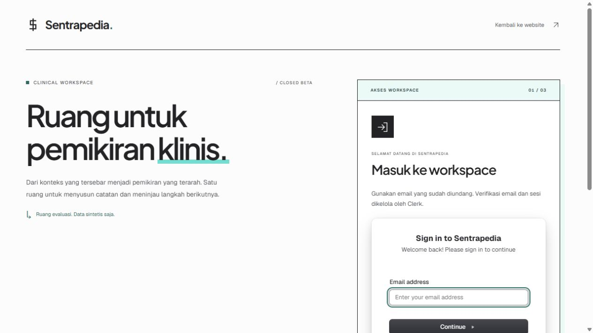

# Clerk development activation — 2026-10-24

## Scope and authority

Gaffer selected existing application `app_3L7xAG9MgjfvqgrncG8OoonOmuF` (Sentrapedia), approved development setup, and completed Clerk CLI authentication. The supplied authentication-success screenshot confirms CLI login; its generic install/deploy suggestions are not deployment or migration instructions.

The existing Next.js integration and pinned SDK generation remain unchanged. No `init`, accountless application, dependency upgrade, global agent-skill installation, production instance creation, user creation, invitation, deployment, merge or Cloudflare change was performed.

## Environment and remote configuration

- Clerk CLI 4.0.0; Node 24.21.0; development instance `ins_3L7xAD9Mpo6bZAqgCEqMZbi5mgm`.
- `npx -y clerk@latest link --app app_3L7xAG9MgjfvqgrncG8OoonOmuF` exited 0. The CLI resolves this application through the monorepo Git remote; subsequent instance commands explicitly name the application and development instance.
- `env pull --app app_3L7xAG9MgjfvqgrncG8OoonOmuF --instance dev --file <absolute-capsule-path>/.env.local` exited 0. The destination is capsule-local and ignored by Git. Existing environment-file contents and credential values were not printed or copied into tracked files.
- Remote configuration patches passed `config patch --dry-run` before `--yes`, then selected-field `config pull` confirmed the applied settings:

| Setting | Development result |
| --- | --- |
| Access mode | `waitlist` |
| Email registration | Required; email-code verification |
| Email sign-in | `email_code` |
| Password | Disabled and not required |
| Username | Disabled for registration/sign-in and not required |
| Google / X OAuth | Disabled |
| Phone / Web3 / passkey sign-in | Disabled |
| Organizations | Disabled |
| Legal consent | Required |
| Privacy / terms URLs | `https://sentrapedia.vercel.app/privasi/`, `https://sentrapedia.vercel.app/ketentuan/` |
| Home / sign-in / sign-up / waitlist | `/`, `/sign-in`, `/sign-up`, `/apply` |
| After sign-out-all | `/sign-in` |

Both legal URLs returned HTTP 200. The backend user count was zero before and after configuration. This activation did not create a demo account or approve a tester.

## Runtime and verification

The earlier preview process masked the new keys with empty process-level variables. Removing those variables and restarting Next in development mode enabled the existing integration without changing authentication source code. The `127.0.0.1` preview also produced an internal rewrite to `localhost` followed by `ECONNRESET`; binding and browsing the same `localhost` hostname resolved that preview issue. Use `http://localhost:3422`, not the previous preview URL.

Auth-only preview command, from the capsule root after removing empty process-level key/origin overrides:

```powershell
$env:NODE_ENV='development'
$env:SENTRAPEDIA_AUTH_MODE='clerk'
$env:NEXT_TELEMETRY_DISABLED='1'
node node_modules/next/dist/bin/next dev --hostname localhost --port 3422
```

This starts the authentication frontend only; it does not start the clinical engine or make paid inference calls.

| Check | Observed result |
| --- | --- |
| `npx -y clerk@latest doctor --json` | Exit 0; auth, app reachability and dev environment pass. Warning: production instance not configured. |
| `npx vitest run tests/beta-auth.test.ts tests/beta-auth-pages.test.tsx tests/beta-auth-routes.test.ts tests/beta-auth-proxy.test.ts tests/aadi-beta-access.test.ts tests/ui/beta-auth.test.tsx tests/ui/auth-design.test.tsx` | Exit 0; JSON reporter confirms 54 passed, 0 failed. |
| `npm run typecheck` | Exit 0. |
| `git.exe check-ignore .env.local` | Matches `.env.local`. |
| Browser `/sign-in` | Native Clerk email-only field and Continue button render; development-mode label visible. |
| Browser `/apply` | Native Clerk Waitlist email form renders. No request submitted. |
| Browser `/sign-up` without invitation | Native Clerk “Access restricted” state; Join waitlist action. |
| Browser `/` without session | Navigates to `/sign-in`; workspace not shown. |
| HTTP POST `/api/aadi`, anonymous | 401 `AUTH_REQUIRED`; no clinical processing. |
| HTTP POST `/api/onboarding/consent`, anonymous, local or foreign Origin | 401 `AUTH_REQUIRED`; no consent granted. This does not prove signed-in cross-origin handling. |



## Remaining release acceptance

Real pending/approval/invitation delivery, registration legal acceptance, email OTP delivery, consent, suspension and two-user isolation remain unverified against this instance. No test-user creation or legally binding acceptance was automated. Gaffer must approve the intended tester; the person completes their own legal acceptance and login.

Production provisioning, sender/domain verification and deployment are separate work. Keep the live Cloudflare gate and published marketing destinations unchanged until separately authorized release and cutover. This record proves development activation and anonymous/native-component checks, not a production release or complete email end-to-end test.
